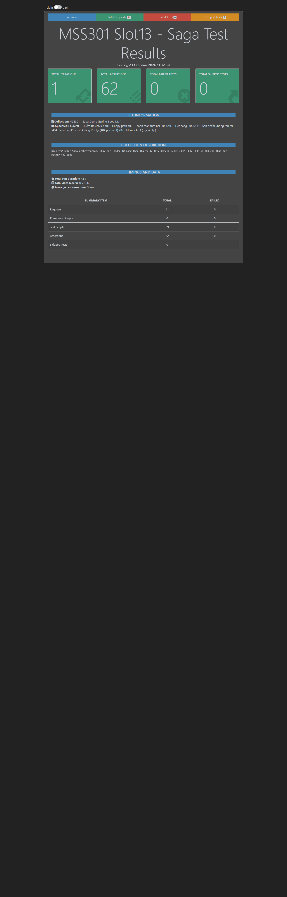
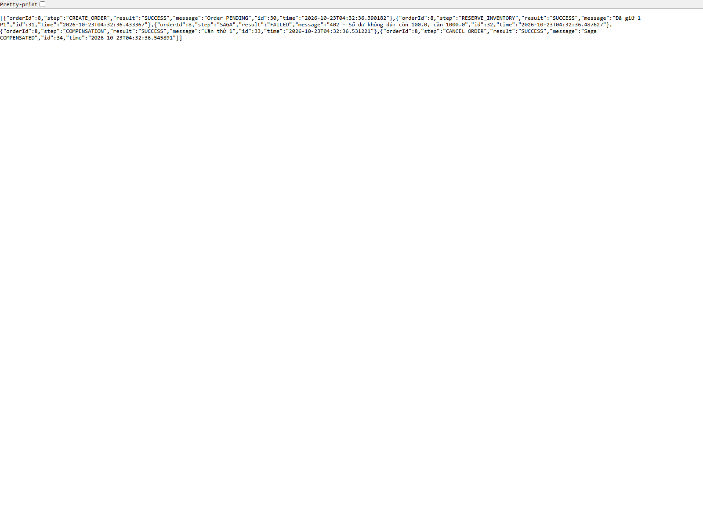

# Kết quả kiểm thử Saga

Thời điểm kiểm thử: 23/10/2026 (Asia/Bangkok).

## Build và unit test

Lệnh:

```powershell
.\mvnw.cmd test
```

Kết quả: **17 test pass, 0 failure, 0 error**.

| Service | Test | Số lượng |
|---|---|---:|
| inventory-service | `InventoryServiceTest` | 3 |
| payment-service | `PaymentServiceTest` | 4 |
| order-service | `OrderServiceTest` | 4 |
| order-service | `OrderSagaOrchestratorTest` | 4 |
| order-service | `OrderControllerTest` | 2 |

## Docker Compose

`docker-compose up -d --build` build thành công ba image ứng dụng. Sáu container đều chạy;
MySQL 8.4, SQL Server 2022 và MongoDB 8.0 đều báo `healthy`.

## Newman / Postman Collection Runner

Đã chạy theo thứ tự `0 → KB1 → KB2 → KB3 → KB4 → KB5 → KB7`.

| Chỉ số | Executed | Failed |
|---|---:|---:|
| Iterations | 1 | 0 |
| Requests | 41 | 0 |
| Test scripts | 39 | 0 |
| Assertions | 62 | 0 |



Các kiểm tra chính đã pass:

- KB1: order `CONFIRMED`, Saga `COMPLETED`, P1 giảm 2 và ví C1 giảm 2000.
- KB2: payment trả 402, order `CANCELLED`, Saga `COMPENSATED`, kho/ví không đổi.
- KB3: inventory trả 409 và không chạy release khi reserve chưa thành công.
- KB4: inventory trả 404 cho P9.
- KB5: payment trả 404 cho C9 và inventory được hoàn tác.
- KB7: reserve/pay/release/refund gọi lặp không làm thay đổi kho hoặc ví.

## KB6 – payment-service không phản hồi

Đã dừng thật `payment-service`, gửi order, sau đó bật service lại.

| Thuộc tính | Kết quả |
|---|---|
| Order ID | 6 |
| Order status | `CANCELLED` |
| Saga status | `COMPENSATED` |
| Failure reason | bắt đầu bằng `Service không phản hồi` |
| P2 trước / sau | `5 / 5` |
| Saga steps | `CREATE_ORDER → RESERVE_INVENTORY → SAGA → COMPENSATION → CANCEL_ORDER` |

KB8 là kịch bản mở rộng tuỳ chọn và đã được chuẩn bị sẵn trong collection để chạy thủ công.

Ảnh saga logs của KB2 (lần chạy bằng chứng thứ hai, order ID 8):


